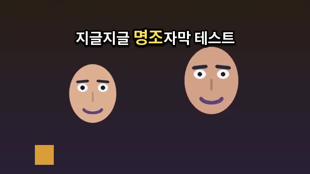
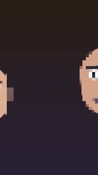
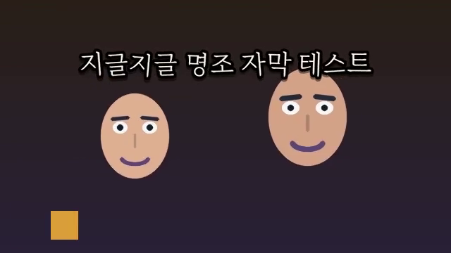

# 🎬 릴컷 스튜디오 (reelcut studio)

숏폼(릴스·숏츠·틱톡)을 위한 **자동 AI 자막 + 추적 모자이크** 영상 편집기.
브라우저에서 바로 편집하고, 서버가 **미리보기와 똑같은** MP4를 렌더링합니다.

- 프론트엔드: React 19 + TypeScript + Vite + Tailwind CSS (다크 스튜디오 테마, PC/모바일 반응형)
- 백엔드: FastAPI + FFmpeg + OpenCV + Pillow + faster-whisper
- 통합 `Dockerfile` 하나로 빌드 → FastAPI가 정적 파일과 API를 같은 오리진에서 서빙 (`PORT` 지원, Cloud Run 바로 배포 가능)



---

## ✨ 주요 기능

### 1. 영상 업로드 · 기본 편집
- MP4 / MOV / WebM 업로드(최대 5분, 250MB 기본값 — 환경변수로 조정)
- 재생/일시정지, 프레임 단위 이동, 타임라인 시크, **시작·끝 트림**
- 화면 비율 프리셋: **원본 / 9:16(릴스·숏츠) / 1:1 / 16:9 / 4:5** — 가운데 기준 크롭
- 브라우저 재생을 위한 HTTP Range 스트리밍, 썸네일 API

### 2. AI 자동 자막 (단어 단위 타이밍)
- 오디오를 16kHz 모노로 추출 → `faster-whisper` `word_timestamps=True` 로 단어별 시작/끝 추출
- 숏폼에 맞게 **짧은 큐(최대 16자 / 6단어 / 0.55초 공백 기준)** 로 자동 분절
- 자막 텍스트·시작/끝 시간·폰트·크기·색·강조색·세로 위치(Y%)·줄 간격·최대 폭 **모두 수동 편집**
- 자막 추가/삭제, 행 클릭으로 해당 시점 이동

#### 자막 스타일 프리셋 (요즘 릴스·숏츠 스타일)
| 프리셋 | 설명 |
| --- | --- |
| ✨ 단어 강조 | 지금 말하는 단어만 강조색 + 살짝 확대 |
| 🎈 바운스 팝업 | 줄마다 통통 튀어오르는 등장 |
| 🏷️ 둥근 박스 | 둥근 흰 배경 박스 + 진한 글자 |
| 🖊️ 굵은 외곽선 | 두꺼운 외곽선으로 어떤 배경에서도 또렷 |
| 〰️ **지글지글** | 글자마다 미세하게 회전·이동하는 삐뚤빼뚤 아날로그 감성(명조·손글씨와 찰떡) |
| ⚪ 심플 | 군더더기 없는 기본 자막 |

`지글지글`은 **결정적 정수 해시**(초당 12스텝)로 흔들림을 만들기 때문에 **Canvas 미리보기와 최종 MP4가 프레임 단위로 동일**합니다.

### 3. 추적 모자이크 · 블러
- 저장소에 포함된 OpenCV **Haar 캐스케이드**(정면/측면)로 얼굴 검출 —
  검출이 어려운 프레임은 **피부색 후보 영역**으로 보완(외부 모델 다운로드 없음)
- IoU + 중심 거리 매칭으로 **인물별 `track_id`** 부여, 표본 사이는 선형 보간 + 스무딩
- 인물별 **ON/OFF 토글**, 미리보기에서 **드래그해 수동 영역 추가**(시간 구간 지정)
- 효과: **블러(Gaussian) ↔ 모자이크(픽셀)** 선택, **사각형/타원/원형** 마스크, **강도 1~100%** 슬라이더
- 강도 공식이 프론트·백엔드 동일 (`sigma = (0.5 + 20·s)·max(1, min(w,h)/120)` 등)



### 4. 내보내기
- 작업(job) 기반 비동기 렌더링 + 진행률 표시
- 완성된 MP4 **다운로드** 및 결과 미리보기(스트리밍)
- H.264 / AAC, `+faststart`

---

## 🗂 구조

```
video-editor/
├─ Dockerfile                 # 멀티스테이지: 프론트 빌드 → FastAPI 정적 서빙
├─ .dockerignore / .gitignore
├─ backend/
│  ├─ app/
│  │  ├─ main.py              # FastAPI 라우트·정적 서빙
│  │  ├─ config.py            # 환경변수·경로·ffmpeg 해석
│  │  ├─ models.py            # 편집 스펙(Pydantic)
│  │  ├─ media.py             # ffmpeg 파이프 인코딩·프로브·오디오 추출
│  │  ├─ tracking.py          # Haar + 피부색 보완 얼굴 검출·트래킹
│  │  ├─ transcribe.py        # faster-whisper 자동 자막·큐 분절
│  │  ├─ layout.py            # 자막 레이아웃/애니메이션 (TS와 1:1)
│  │  ├─ subtitle_draw.py     # Pillow 자막 렌더러
│  │  ├─ renderer.py          # 크롭·마스크·자막 → MP4 파이프라인
│  │  ├─ fonts.py             # 폰트 카탈로그(/api/fonts)
│  │  ├─ store.py             # 프로젝트/작업 저장소·스레드 풀
│  │  └─ vendor/              # Haar 캐스케이드 XML (오프라인 동작)
│  ├─ fonts/                  # 한글 폰트 17종 (프론트도 이 파일을 그대로 받는다)
│  ├─ tests/                  # E2E 테스트(실제 API·실제 MP4 검증)
│  └─ requirements.txt
└─ frontend/
   ├─ src/
   │  ├─ App.tsx              # 편집 상태 오케스트레이션
   │  ├─ lib/layout.ts        # backend/app/layout.py 와 동일한 좌표 계산
   │  ├─ lib/preview.ts       # Canvas 미리보기 렌더러
   │  ├─ lib/fonts.ts         # /api/fonts 의 TTF 를 @font-face 로 등록
   │  ├─ lib/api.ts, presets.ts, format.ts
   │  └─ components/          # PreviewStage, Timeline, SubtitlePanel, MaskPanel, ExportPanel …
   └─ scripts/parity.ts       # 프론트↔백엔드 레이아웃 일치 검증 하네스
```

---

## 🔤 한글 폰트 (10종 / 17파일)

요즘 릴스·숏츠·브이로그에서 많이 쓰는 무료 폰트를 **실제 TTF로 저장소에 포함**했습니다.
프론트엔드는 `/api/fonts`로, 백엔드는 `backend/fonts`의 **같은 파일**을 쓰기 때문에 미리보기와 결과물의 글꼴이 100% 일치합니다.

| 폰트 | 분류 | 파일 |
| --- | --- | --- |
| 프리텐다드 (Pretendard) | 고딕 | regular / bold / extrabold |
| G마켓 산스 | 고딕·임팩트 | regular / bold |
| 검은고딕 (Black Han Sans) | 임팩트 | regular |
| Noto Sans KR | 고딕 | regular / bold |
| 나눔명조 | 명조 | regular / bold |
| 마루부리 | 명조 | regular |
| 나눔손글씨 펜 | 손글씨 | regular |
| 개구 (Gaegu) | 손글씨 | regular / bold |
| 주아 (Jua) | 둥근모꼴 | regular |
| 갈무리 11 (Galmuri) | 레트로 픽셀 | regular |

용량을 줄이기 위해 **한글 음절 전체 + 자모 + ASCII + 주요 문장부호**로 서브셋했고(원본 대비 1/4 수준), 라이선스·출처는 [`backend/fonts/LICENSE.md`](backend/fonts/LICENSE.md)에 정리했습니다.



---

## 🚀 실행

### 1) Docker (권장)
```bash
docker build -t reelcut .
docker run --rm -p 8080:8080 reelcut
# → http://localhost:8080
```

### 2) Google Cloud Run
```bash
gcloud run deploy reelcut --source . --port 8080 \
  --memory 4Gi --cpu 2 --timeout 900 --allow-unauthenticated
```
- `PORT` 환경변수를 그대로 사용합니다.
- 첫 자동 자막 요청 때 whisper 모델(기본 `base`, 약 140MB)을 내려받습니다.
  더 가볍게 쓰려면 `WHISPER_MODEL=tiny`, 정확도를 높이려면 `small`/`medium`으로 지정하세요.
  모델을 이미지에 미리 넣고 싶다면 빌드 단계에서 `WHISPER_MODEL` 다운로드를 추가하면 됩니다.

### 3) 로컬 개발
```bash
# 백엔드
cd backend
python -m venv .venv && source .venv/bin/activate
pip install -r requirements.txt
# ffmpeg 가 없다면: pip install imageio-ffmpeg (자동 사용)
uvicorn app.main:app --reload --port 8080

# 프론트엔드 (다른 터미널)
cd frontend
npm install
npm run dev        # http://localhost:5173 → /api 는 8080 으로 프록시
```

### 환경변수
| 이름 | 기본값 | 설명 |
| --- | --- | --- |
| `PORT` | 8080 | 서버 포트 |
| `WORK_DIR` | 시스템 임시폴더 | 업로드·출력 작업 폴더 |
| `FONT_DIR` | `backend/fonts` | 폰트 폴더 |
| `STATIC_DIR` | `frontend/dist` 또는 `/app/static` | 정적 파일 |
| `MAX_UPLOAD_MB` | 250 | 업로드 한도 |
| `MAX_DURATION_SEC` | 300 | 최대 영상 길이 |
| `WHISPER_MODEL` / `WHISPER_DEVICE` / `WHISPER_COMPUTE` | `base` / `cpu` / `int8` | 자막 모델 |
| `TRACK_SAMPLE_FPS` | 6 | 얼굴 분석 표본 (초당) |
| `SKIN_FALLBACK` | 1 | Haar 실패 시 피부색 보완 |
| `OUTPUT_FPS_CAP` | 30 | 출력 최대 fps |

---

## 🔌 API 요약

| 메서드 | 경로 | 설명 |
| --- | --- | --- |
| GET | `/api/health` | 상태·ffmpeg·폰트·ASR 가용성 |
| GET | `/api/fonts` | 폰트 카탈로그 |
| GET | `/api/fonts/file/{name}` | 폰트 파일(TTF) 서빙 |
| POST | `/api/projects` | 영상 업로드(multipart `file`) |
| GET | `/api/projects/{id}` | 프로젝트 메타 + 트랙 |
| GET | `/api/projects/{id}/video` | Range 스트리밍 |
| GET | `/api/projects/{id}/thumbnail?t=` | 썸네일 JPEG |
| POST | `/api/projects/{id}/detect-faces` | 얼굴 검출·트래킹 job |
| GET | `/api/projects/{id}/tracks` | 저장된 인물 트랙 |
| POST | `/api/projects/{id}/transcribe` | 자동 자막 job |
| POST | `/api/projects/{id}/render` | 최종 MP4 job (편집 스펙 JSON) |
| GET | `/api/jobs/{id}` | 작업 상태·진행률·결과 |
| GET | `/api/jobs/{id}/download` | 결과 MP4 다운로드 |

편집 스펙(요약):
```json
{
  "trim": { "start": 0, "end": 12.5 },
  "aspect": "9:16",
  "subtitles": {
    "enabled": true,
    "cues": [{ "id": "cue-1", "start": 0.4, "end": 1.8, "text": "안녕하세요",
               "words": [{ "text": "안녕하세요", "start": 0.4, "end": 1.8 }] }],
    "style": { "preset": "jiggle", "font": "maruburi", "fontSize": 8, "wobble": 60, "yPercent": 72 }
  },
  "masks": {
    "enabled": true, "mode": "blur", "shape": "ellipse", "strength": 65, "pad": 0.18,
    "tracks": [{ "id": 1, "enabled": true }],
    "manual": [{ "id": "m1", "x": 0.1, "y": 0.2, "w": 0.25, "h": 0.3, "start": 0, "end": 5 }]
  }
}
```

---

## ✅ 검증 (직접 실행한 결과)

### 프론트엔드
```bash
cd frontend
npx tsc --noEmit -p tsconfig.app.json   # 타입 검사 통과
npm run build                            # tsc -b && vite build 통과
npm run parity                           # 레이아웃 일치 하네스 실행
npm run smoke                            # 서버 렌더 스모크(앱 구조 검사)
```

### 백엔드 E2E (`backend/tests`)
ffmpeg + OpenCV로 **움직이는 얼굴 2개가 있는 테스트 영상**을 만들고, 실제 API를 호출해
출력 MP4를 프레임 단위로 검사합니다.

```bash
cd backend
python -m pytest                 # 15 passed (ASR 포함)
python -m pytest -m "not slow"   # 모델 다운로드 없이 빠르게
```

검사 항목:
1. **폰트** — 10종 17파일 모두 서빙·Pillow 로드·한글 글리프 존재
2. **업로드** — 메타(640×360, 5초, 오디오 유무), Range 206 응답, 썸네일
3. **얼굴 추적** — 인물별 트랙 생성, 박스가 실제로 움직이는지, 저장/재조회
4. **블러 강도** — 8% vs 92% 렌더 결과의 영역 내 변화량 비교(강할수록 더 흐려짐, 라플라시안 검사)
5. **픽셀 모자이크** — 영역 내 고유 색 수 감소, 타원 마스크 가장자리 보존
6. **수동 영역** — 지정 구간에만 적용되고 구간이 끝나면 원본과 일치
7. **자막 프리셋 5종** — highlight/bounce/box/outline/jiggle 렌더, 자막 픽셀 존재,
   지글지글은 프레임 간 흔들림까지 확인, 구간 밖에서는 자막이 사라짐
8. **트림·비율** — 9:16 / 1:1 출력 크기와 길이, 오디오 유지
9. **자동 자막(ASR)** — TTS 음성 → faster-whisper → 큐 생성 → 그 큐로 렌더까지
10. **레이아웃 파리티** — 같은 입력에서 TS(Canvas)와 Python(Pillow)의 줄바꿈·baseline·토큰 좌표·
    바운스/지글지글 값·크롭 기하·블러/픽셀 공식이 **수치적으로 동일**한지 비교

---

## 🧠 미리보기 = 결과물, 어떻게 보장하나
1. **같은 폰트 파일** — 프론트는 `/api/fonts/file/...` 로 백엔드 폰트를 그대로 로드
2. **같은 좌표 계산** — `layout.ts` ↔ `layout.py` (줄바꿈 추정, baseline, 토큰 x, 박스)
3. **같은 애니메이션** — 바운스 곡선, 지글지글 정수 해시(프레임 스텝 12fps)
4. **같은 마스크 공식** — 블러 sigma·픽셀 블록 크기·크롭 기하를 양쪽에 동일하게 구현
5. `npm run parity` + `pytest` 로 수치 비교를 자동화

---

## 📌 알려진 제약
- 화면 비율 변환은 **가운데 크롭** 방식입니다(레터박스/블러 배경 채우기는 미포함).
- 얼굴 검출은 Haar + 피부색 보완이라 정면·측면 위주이며, 아주 작은 얼굴이나 심한 역광은 놓칠 수 있습니다.
  → 미리보기에서 **직접 영역 지정**으로 항상 보완할 수 있습니다.
- 자동 자막은 CPU `faster-whisper` 기준이며, 첫 요청 시 모델 다운로드가 필요합니다.
- 렌더링은 서버 CPU를 사용합니다(영상 길이에 비례).
